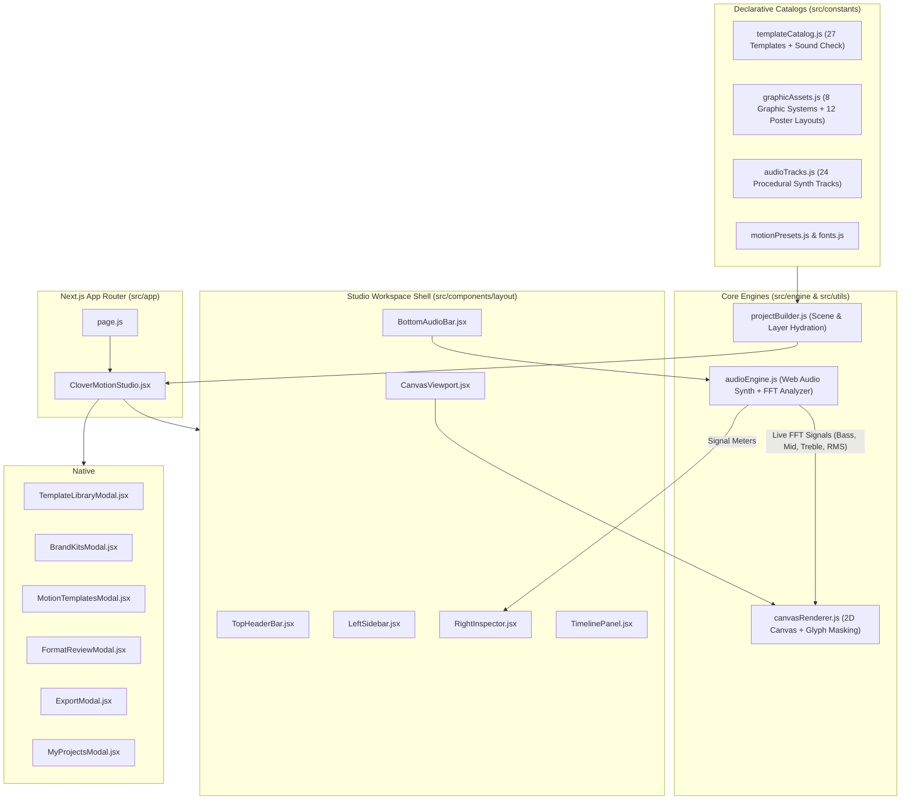

<div align="center">


# Clover Motion (`clover.motion`)

**Interactive Kinetic Typography, Swiss Graphic Systems & Audio-Reactive Motion Studio**

[](https://github.com/edisanturtle/clover-motion-studio/actions/workflows/ci.yml)
[-000000?logo=next.js&logoColor=white)](https://nextjs.org/)
[](https://react.dev/)
[](https://tailwindcss.com/)
[](https://developer.mozilla.org/en-US/docs/Web/API/Web_Audio_API)
[](./LICENSE)

<p align="center">
  <em>Type, shape, and sound — engineered in a clean, modular Next.js architecture ready for Feed (4:5), Square (1:1), and Story (9:16).</em>
</p>

[Features](#-key-features) •
[Architecture](#-system-architecture) •
[Project Structure](#-directory-structure) •
[Quick Start](#-quick-start) •
[Shortcuts](#-keyboard-shortcuts) •
[Contributing](./CONTRIBUTING.md)

</div>

---

## ✨ Key Features

| Module | Capabilities |
| :--- | :--- |
| **🎬 27 Motion Templates + Sound Check** | Curated across **Start here** (`Hangul Modules`, `Pattern Playground`, `Shutter Play`, `Split Signal`, `Paper Stack`, `Prism Radio`), **Kinetic type**, **Graphic systems**, **Expert collection** (`16s / 4 scenes`), **Studio collection**, and the `60s` **Sound check** starter. |
| **📐 12 Swiss Poster Layouts** | Architectural typographic blueprints (`01 Stacked` through `12 Wide margin`) that re-layout any active scene while preserving your copy. |
| **⚡ Dual Studio Modes** | **Quick Editor** for 3-step guided personalization (`Content`, `Style`, `Motion`, `Sound`) and **Advanced Studio** (`Design | Motion`) with full layer stack, custom font/SVG uploads, and workspace panel toggles. |
| **⏱️ Keyframe Timeline & Value Graph** | Multi-track timeline with proportional `Scenes` bar, expandable layer property sub-rows (`Position X`, `Position Y`, `Scale`, `Rotation`, `Opacity`), `Value graph` curve editor, and `Beats & markers` tools. |
| **🔊 24-Track Procedural Web Audio Engine** | Zero external audio file dependencies — synthesizes kicks, snares, hats, basslines, and chords in real time via Web Audio API, plus custom `.mp3/.wav` upload, live Microphone input, and 5 real-time FFT signal meters (`Amplitude`, `Bass`, `Mids`, `Treble`, `Transients`). |
| **🖼️ Resolution-Independent 2D Renderer** | Offscreen `source-in` glyph-mask pattern clipping (`글자 놀이`, `VOID INDEX`), 4×4 Swiss grid overlays, double-dashed safe-area guides, and on-canvas selection HUD with 8 resize handles + rotation handle (`↻`). |
| **📦 Multi-Format Review & Export** | Side-by-side `Feed · 4:5` (`1080×1350`), `Square · 1:1` (`1080×1080`), and `Story · 9:16` (`1080×1920`) format verifier, real-time `WebM`/`MP4` video recording, `PNG` still capture, `SVG` export, `CSS keyframes` export, and `.clovermotion.json` project serialization. |

---

## 🏗️ System Architecture



---

## 📂 Directory Structure

```text
clover-motion-studio/
├── .github/
│   ├── ISSUE_TEMPLATE/                     # Standardized bug & feature request templates
│   ├── workflows/ci.yml                    # GitHub Actions CI build pipeline (Node 22)
│   └── pull_request_template.md            # Pull request verification checklist
├── public/
│   └── favicon.svg                         # Clover Motion 'c' + 4-leaf clover SVG icon
├── src/
│   ├── app/
│   │   ├── globals.css                     # Tailwind CSS v4 + Clover Green theme variables + <dialog> rules
│   │   ├── icon.svg                        # App Router SVG icon
│   │   ├── layout.js                       # Root layout & metadata
│   │   └── page.js                         # Entry point rendering <CloverMotionStudio />
│   ├── components/
│   │   ├── CloverMotionStudio.jsx          # Top-level Studio orchestrator (state, history, playback, export)
│   │   ├── common/
│   │   │   ├── BrandLogo.jsx               # 4-leaf Clover SVG emblem & clover.motion wordmark
│   │   │   └── ModalDialog.jsx             # Native <dialog closedby="any"> wrapper with light-dismiss
│   │   ├── layout/
│   │   │   ├── TopHeaderBar.jsx            # Mode switchers, workspace toggles, overflow menu & Export CTA
│   │   │   ├── LeftSidebar.jsx             # Collapsible icon rail, Quick Edit, Graphics, Scenes & Stack
│   │   │   ├── CanvasViewport.jsx          # Interactive stage, Colors popover, zoom & on-canvas HUD
│   │   │   ├── SceneStripCard.jsx          # Live mini-canvas scene thumbnails
│   │   │   ├── RightInspector.jsx          # Design, Motion & 5-band Audio Signal Meters inspector
│   │   │   ├── TimelinePanel.jsx           # Proportional Scenes bar, Keyframes track list & Value Graph
│   │   │   └── BottomAudioBar.jsx          # Categorized audio track popover, waveform scrubber & FFT bars
│   │   └── modals/
│   │       ├── TemplateLibraryModal.jsx    # 27-template Motion Library + 12 Poster Layout visual cards
│   │       ├── LiveTemplatePreviewInspector.jsx # Live multi-format interactive preview inside library
│   │       ├── BrandKitsModal.jsx          # 3-column Brand Kits editor (palette, typography & logo)
│   │       ├── MotionTemplatesModal.jsx    # Preset & custom saved kinetic motion templates
│   │       ├── FormatReviewModal.jsx       # Side-by-side 4:5, 1:1 & 9:16 inspection modal
│   │       ├── ExportModal.jsx             # WebM/MP4 recorder, PNG still & Project JSON exporter
│   │       ├── MyProjectsModal.jsx         # Private workspace project manager & template storage
│   │       ├── FullscreenPreviewModal.jsx  # Theater fullscreen live canvas player
│   │       └── HelpShortcutsModal.jsx      # Keyboard shortcuts reference dialog
│   ├── constants/
│   │   ├── audioTracks.js                  # 24 procedural synth tracks, use-case recommendations & groups
│   │   ├── fonts.js                        # Curated display/editorial/mono/Korean fonts & aspect ratios
│   │   ├── graphicAssets.js                # 8 Graphic Templates, 15 Vector Shapes & 12 Poster Blueprints
│   │   ├── motionPresets.js                # Kinetic motion presets & curated color palettes
│   │   └── templateCatalog.js              # Complete 27-template catalog + Sound Check starter
│   ├── engine/
│   │   ├── audioEngine.js                  # Procedural Web Audio synthesizer + FFT analyzer + Mic/File input
│   │   └── canvasRenderer.js               # HTML5 2D Canvas renderer, glyph masking & selection HUD
│   └── utils/
│       ├── projectBuilder.js               # Multi-format scene & layer hydration engine
│       └── timecode.js                     # SMPTE timecode formatter (HH:MM:SS:FF) & easing evaluators
├── CHANGELOG.md                            # Release history
├── CONTRIBUTING.md                         # Developer & AI agent contribution guide
├── LICENSE                                 # MIT License
└── package.json                            # Scripts & dependencies
```

---

## 🚀 Quick Start

### Prerequisites
- **Node.js** `>= 20.x` (Node `22.x` recommended)
- **npm** `>= 10.x`

### Installation & Local Development

```bash
# 1. Clone the repository
git clone https://github.com/edisanturtle/clover-motion-studio.git
cd clover-motion-studio

# 2. Install dependencies
npm install

# 3. Start the development server at http://localhost:3000
npm run dev
```

### Production Build

```bash
npm run build
npm start
```

---

## ⌨️ Keyboard Shortcuts

| Shortcut | Action |
| :--- | :--- |
| `SPACE` | Play / Pause real-time canvas & audio demo |
| `F` | Toggle Fullscreen Theater Preview |
| `⌘Z` / `Ctrl+Z` | Undo last project action |
| `⇧⌘Z` / `Ctrl+Y` | Redo project action |
| `+` / `-` / `0` | Zoom in / Zoom out / Reset zoom to `Fit` |
| `Arrow Keys` (`+Shift`) | Nudge selected layer on canvas by `1px` (`10px` with `Shift`) |
| `ESC` | Close active modal or exit fullscreen preview |
| `?` | Open Keyboard Shortcuts & Help modal |

---

## 🤖 Guide for AI Coding Agents (Codex / Hermes)

This repository is structured for zero-friction continuation in autonomous coding environments:

1. **Adding a Template**: Add the declarative blueprint in `src/constants/templateCatalog.js`, add any custom procedural background in `drawTemplateDecor()` (`src/engine/canvasRenderer.js`), and define layer coordinates in `src/utils/projectBuilder.js`.
2. **Adding a Graphic System**: Register metadata in `src/constants/graphicAssets.js` and implement its 2D vector drawing routine in `drawGraphicAsset()` (`src/engine/canvasRenderer.js`).
3. **Adding an Audio Track**: Append BPM, root frequency, and 16-step pattern in `src/constants/audioTracks.js`.

---

## 📄 License

Distributed under the **MIT License**. See [`LICENSE`](./LICENSE) for full details.
